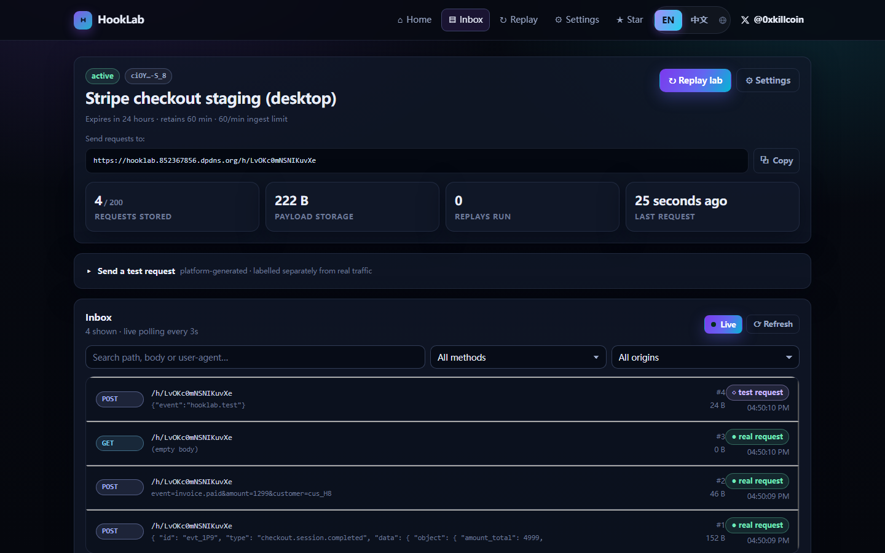
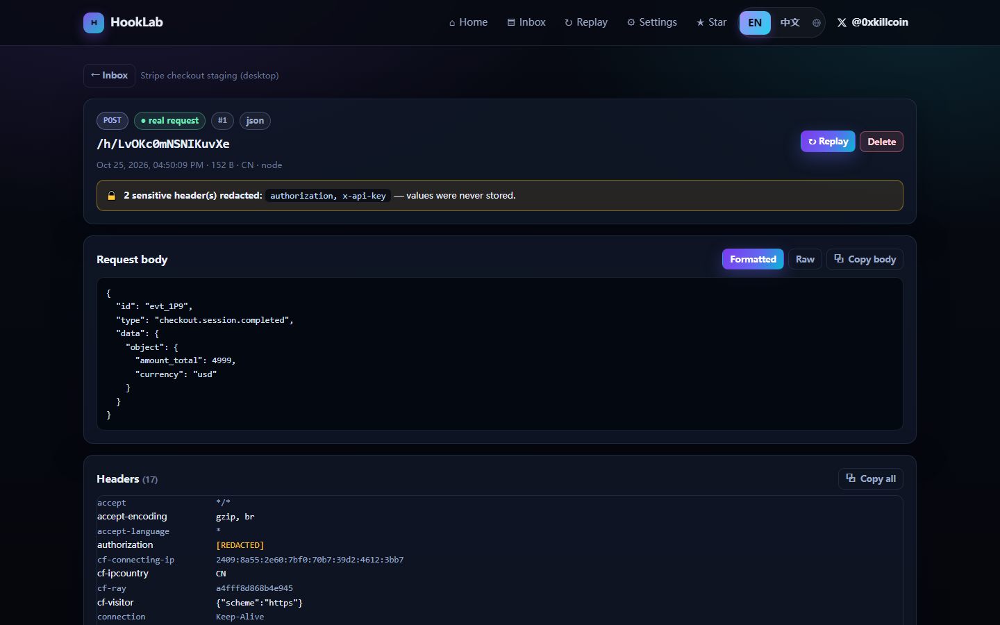
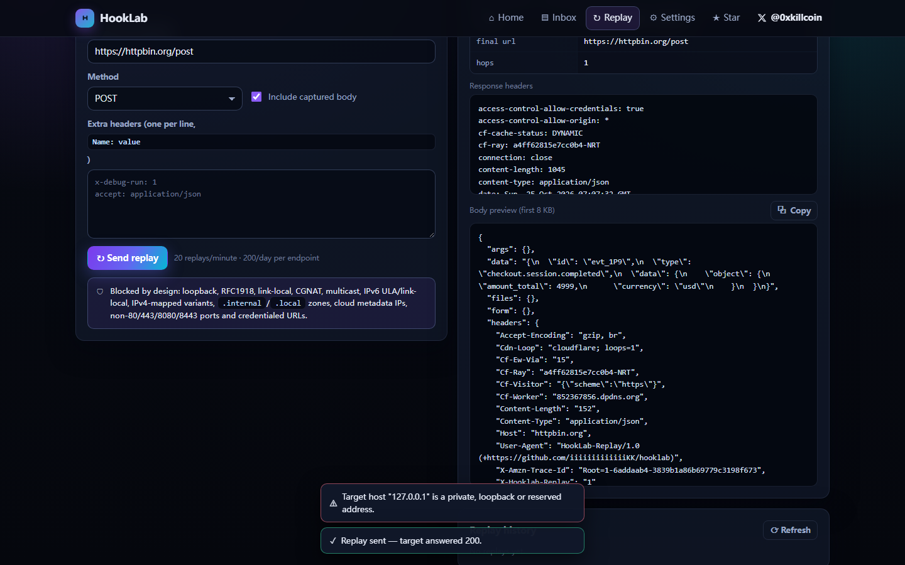
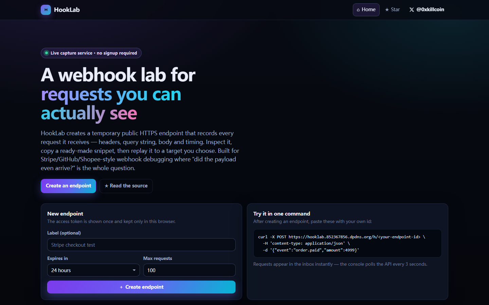
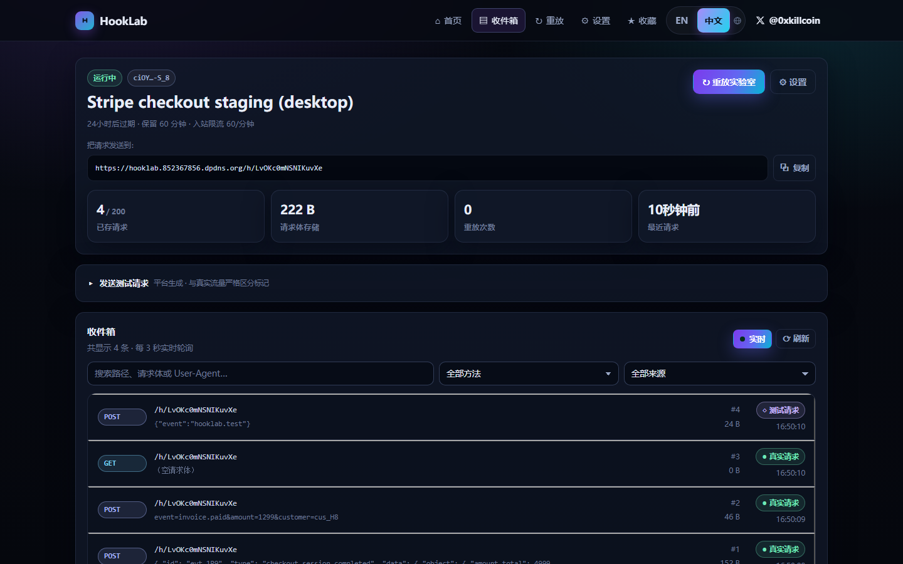
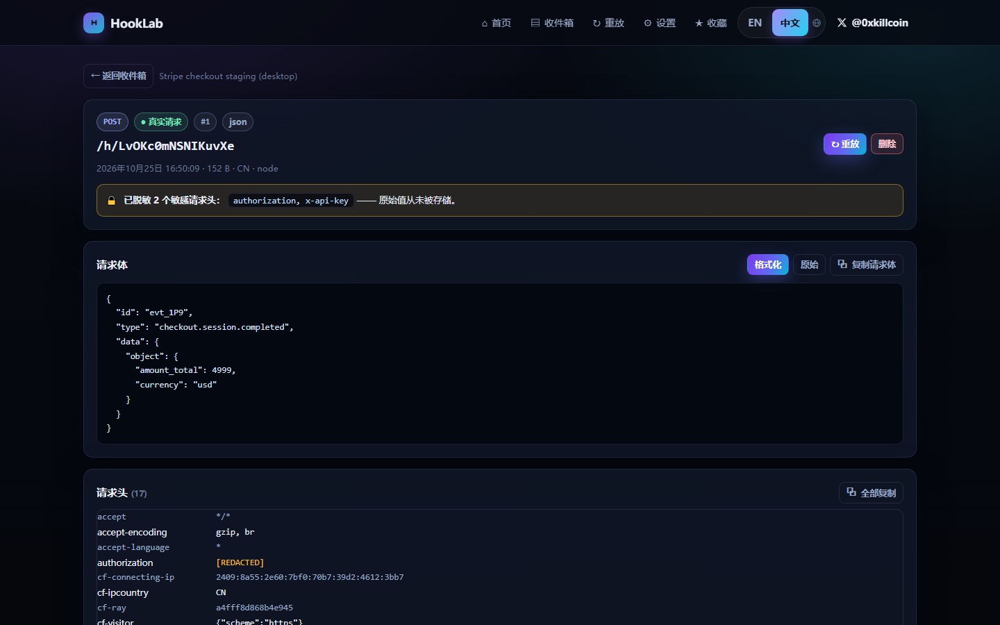
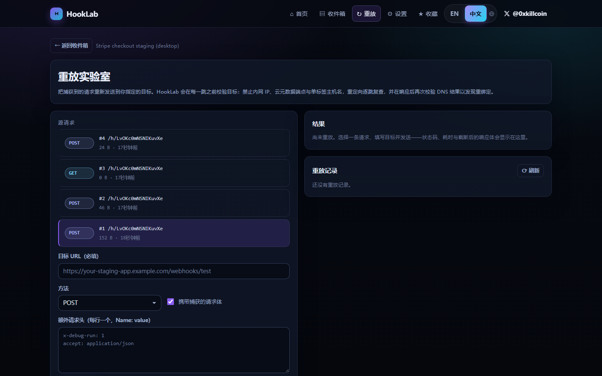
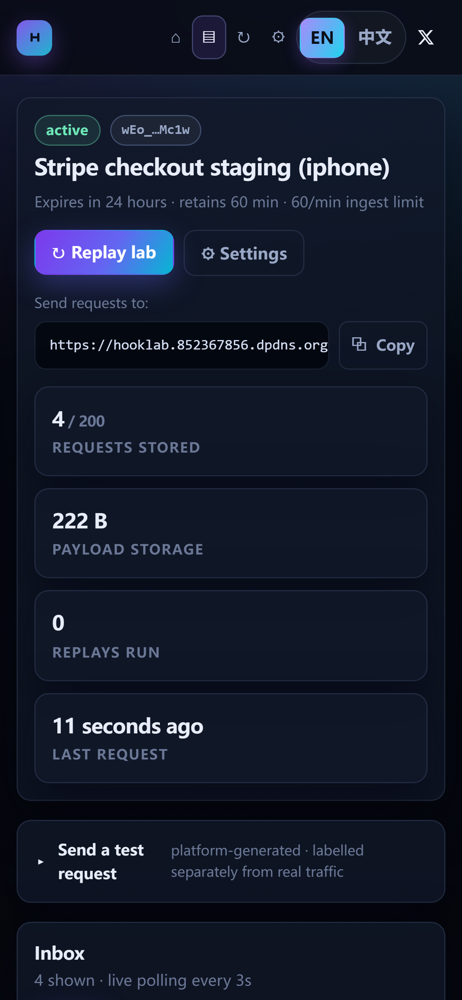
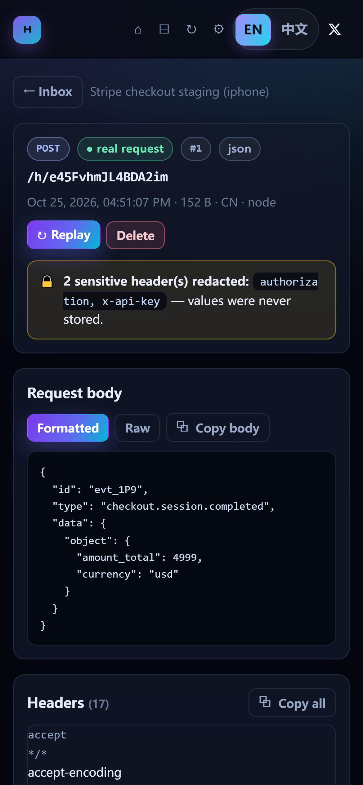
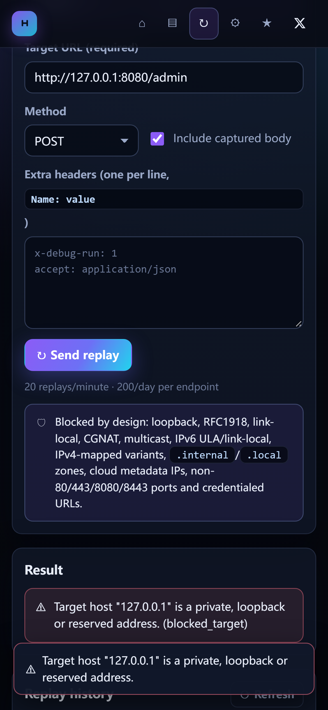

<div align="right">

**English** · [简体中文](README.zh-CN.md)

</div>

# HookLab

> **A webhook lab for developers: capture, inspect and replay HTTP requests at a real public URL.**

HookLab gives you a throwaway HTTPS endpoint that records every request it receives — method, path, query,
headers, body and timing — so you can answer "did the webhook actually arrive, and what exactly did it send?"
in seconds instead of guessing. When you need to reproduce a bug, replay the captured request to a target you
explicitly type, with SSRF protection applied on every hop.

<p align="center">
  <a href="https://hooklab.852367856.dpdns.org"><strong>🔗 Live demo »</strong></a>
  &nbsp;·&nbsp;
  <a href="VERIFICATION.md"><strong>✅ Verification report »</strong></a>
</p>

<p align="center">
  
  
  
  
  
  
</p>

<p align="center">
  <a href="https://x.com/0xkillcoin"><strong>𝕏 @0xkillcoin</strong></a> ·
  <a href="#quick-start">Quick start</a> ·
  <a href="#api-reference">API</a> ·
  <a href="#security-model">Security model</a> ·
  <a href="#deployment">Deployment</a>
</p>

---

## Table of contents

- [What it solves](#what-it-solves)
- [Screenshots](#screenshots)
- [Feature list](#feature-list)
- [Architecture](#architecture)
- [Quick start](#quick-start)
- [Environment variables](#environment-variables)
- [API reference](#api-reference)
- [Data retention rules](#data-retention-rules)
- [Security model](#security-model)
- [Internationalisation](#internationalisation)
- [Testing](#testing)
- [Deployment](#deployment)
- [Project structure](#project-structure)
- [Known limitations](#known-limitations)
- [Roadmap](#roadmap)
- [Contributing](#contributing)
- [License](#license)

---

## What it solves

Webhook debugging is usually a loop of guessing:

1. A payment provider says it sent an event. Your handler says it never arrived.
2. You add logging, redeploy, and ask the provider to resend.
3. Something is still wrong — a header, a signature, an encoding, a redirect.

HookLab removes the guessing. It is a real server-side receiver (Cloudflare Worker + D1), not a browser mock:
any external client — Stripe, GitHub, your CI, `curl` on another machine — can POST to your endpoint and the
request is stored and displayed in a live console within seconds.

**Who it is for:** backend engineers integrating third-party webhooks, QA reproducing flaky callbacks, and
anyone who needs a stable public URL for five minutes without standing up a tunnel.

## Screenshots

All screenshots are captured from the live production deployment by
[`scripts/verify-ui.mjs`](scripts/verify-ui.mjs) (Playwright, desktop + iPhone viewports).

| Inbox (desktop) | Request detail (desktop) |
| --- | --- |
|  |  |

| Replay lab (desktop) | Landing (desktop) |
| --- | --- |
|  |  |

| 中文 — 收件箱 | 中文 — 请求详情 | 中文 — 重放 |
| --- | --- | --- |
|  |  |  |

| iPhone — inbox | iPhone — request detail | iPhone — replay |
| --- | --- | --- |
|  |  |  |

## Feature list

### Capture
- **Temporary public endpoints** with a 96-bit random slug and a 256-bit access token (`hl_…`).
- **Any HTTP method and content type**: JSON, `application/x-www-form-urlencoded`, plain text, XML, and
  arbitrary binary bodies (stored base64, hashed with SHA-256, never rendered as HTML).
- **Full request fidelity**: method, path, query pairs (repeats preserved), every header, byte size,
  receive timestamp, user-agent, coarse country.
- **CORS preflight** handled so browser-based senders work.

### Inspect
- **Fetch polling every 3 seconds** (paused while the tab is hidden) — no WebSocket connection limits to worry
  about on the free tier, and it survives sleep/wake and flaky networks.
- **Search** across path, body text and user-agent; **filters** by HTTP method and origin.
- **Formatted vs raw views**: prettified JSON, decoded form fields, raw text, and a base64 transcript for binaries.
- **Copy** any individual value, all headers, the whole body, or a generated cURL command.
- **Explicit provenance**: every row is labelled `● real request` or `◇ test request`; the platform can never
  present a synthetic request as real traffic.

### Replay
- **Explicit target** — HookLab never replays to an implicit or remembered target.
- **Per-hop SSRF defence**: private/loopback/link-local/CGNAT/multicast ranges, IPv4-mapped and NAT64 forms,
  cloud metadata hosts, internal TLDs, non-80/443/8080/8443 ports and credentialed URLs are rejected.
- **DNS validation before the request and re-validation after** to catch rebinding, plus manual redirect
  following (max 5 hops, every hop re-validated).
- **Bounded responses**: 10 s timeout, 8 KB body preview, at most 40 response headers.
- **Rate limited**: 20 replays/minute and 200/day per endpoint.

### Manage
- **Server-enforced quotas**: TTL, max stored requests, per-minute ingest rate, 128 KiB body cap, 4 MiB
  storage per endpoint, plus a per-IP daily endpoint-creation limit.
- **Retention**: every stored request has its own expiry; sweeps run opportunistically on writes, and expired
  endpoints stop accepting traffic immediately.
- **Deletion**: delete one request, purge all requests, rotate the token, or destroy the endpoint.
- **Sanitised export**: download a JSON debug report with sensitive headers already redacted.
- **Token rotation** invalidates the previous token instantly (only a SHA-256 hash is ever stored).

### Interface
- **Bilingual UI — English / 中文**, switchable from the header (`EN | 中文`). The choice is remembered in
  `localStorage`, applied to `<html lang>` before first paint (no flash of the wrong locale), and also drives
  date/number/relative-time formatting via `Intl`. First visit auto-detects the browser language.
- **Responsive from 320 px up**: single-column inbox on phones, icon-only nav, scroll-contained long bodies,
  ≥ 28 px tap targets. Verified on an emulated iPhone viewport in CI-grade browser tests.

## Architecture

```
                    ┌──────────────────────────────────────────────────────────┐
  Stripe / GitHub   │  Cloudflare Worker  (single deployment, one origin)      │
  curl / CI  ──────▶│                                                          │
                    │   /h/:slug      → ingest handler  ──┐                    │
                    │   /api/*        → JSON API        ──┼──▶  D1 (SQLite)    │
                    │   /*            → static SPA assets ┘                    │
                    │                                                          │
                    │   replay ──▶ SSRF guard ──▶ fetch(target) ──▶ hops log   │
                    └──────────────────────────────────────────────────────────┘
                                        ▲
                          React 19 + TypeScript SPA
                          (Vite build, served from Workers Static Assets)
```

| Layer | Choice | Why |
| --- | --- | --- |
| Edge runtime | Cloudflare Workers | Real inbound HTTP on a public URL, generous free tier, global anycast |
| Database | Cloudflare D1 (SQLite) | Serverless SQL with a free tier; no connection pool to manage |
| Frontend | React 19 + TypeScript + Vite | Small bundle (~86 KB gzip), no router dependency (custom 3 KB router) |
| Static hosting | Workers Static Assets | Same origin as the API → no CORS config for the console, one deploy |
| Live updates | Controlled polling | Free-tier friendly, resilient, and simpler than managing SSE/WebSocket limits |
| Tests | `node:test` + Playwright | Zero extra runtime for unit tests; real browser E2E for responsive checks |

The Worker is the only moving part: it serves the SPA, the JSON API and the ingest route. There is no separate
backend to keep warm, and no cold-start database.

## Quick start

```bash
git clone https://github.com/iiiiiiiiiiiiiKK/hooklab.git
cd hooklab
npm install
```

### 1. Create the database

```bash
npx wrangler d1 create hooklab-db
# copy the printed database_id into wrangler.jsonc
npx wrangler d1 execute hooklab-db --remote --file=migrations/0001_init.sql
```

### 2. Run locally

```bash
npm run build          # build the SPA into dist/
npm run dev:worker     # wrangler dev on http://127.0.0.1:8787
```

For a hot-reloading frontend, run `npm run dev` (Vite on :5173) in a second terminal — it proxies `/api` to
`127.0.0.1:8787`.

### 3. Send your first request

Create an endpoint in the UI (or via `curl -X POST /api/endpoints`), then:

```bash
curl -X POST http://127.0.0.1:8787/h/<your-endpoint-id> \
  -H 'content-type: application/json' \
  -H 'x-api-key: sk_live_demo' \
  -d '{"event":"order.paid","amount":4999}'
```

Open the console: the request appears with `x-api-key` shown as `[REDACTED]`.

## Environment variables

HookLab reads everything from environment variables (Wrangler `vars`/secrets). Nothing is hard-coded.

| Name | Required | Default | Purpose |
| --- | --- | --- | --- |
| `DB` | yes | binding in `wrangler.jsonc` | D1 database binding |
| `ASSETS` | yes | binding in `wrangler.jsonc` | Static asset binding for the SPA |
| `ALLOWED_REPLAY_HOSTS` | no | *(empty = any public host)* | Comma-separated allow-list, e.g. `mycompany.io,hooks.example.com`. When set, replay is restricted to these hosts and their subdomains. |
| `ALLOWED_REPLAY_PORTS` | no | *(empty)* | Extra ports allowed for replay on top of 80/443/8080/8443. |
| `IP_HASH_SECRET` | recommended | `hooklab` | Salt for the IP hashes used by rate limits. Set it with `wrangler secret put IP_HASH_SECRET`. |
| `DEBUG_ERRORS` | no | *(unset)* | Set to `1` to include the error message (never the payload) in 500 responses. Keep it off in production. |

See [`.env.example`](.env.example) for a template. **Never commit real secrets** — this project does not need
any third-party API keys to run.

## API reference

All API responses are JSON. Authenticated routes require the endpoint token in
`x-hooklab-token: hl_…` (an `Authorization: Bearer hl_…` header also works).

### Create an endpoint

```http
POST /api/endpoints
Content-Type: application/json

{
  "name": "Stripe checkout staging",
  "ttlMinutes": 1440,
  "retentionMinutes": 60,
  "maxRequests": 100,
  "rateLimitPerMinute": 60,
  "storeSensitiveHeaders": false
}
```

```json
{
  "endpoint": {
    "id": "6d1f…",
    "slug": "Qm9v…",
    "status": "active",
    "expiresAt": 1792880000000,
    "maxRequests": 100,
    "requestCount": 0,
    "retentionMinutes": 60,
    "rateLimitPerMinute": 60,
    "tokenHint": "a1b2…z9y8",
    "ingestPath": "/h/Qm9v…"
  },
  "token": "hl_…",
  "ingestUrl": "https://hooklab.example.com/h/Qm9v…"
}
```

> The token is returned **once**. Only `sha256(token)` is stored.

### Ingest (the URL you give to a provider)

```http
POST /h/:slug
```

Returns `202 Accepted` with the stored sequence number, `404` for an unknown endpoint, `410` when expired,
`413` when the body exceeds 128 KiB, `429` when rate/quantity limits are hit, and `507` when the endpoint's
storage quota is exhausted.

### Other routes

| Method | Path | Auth | Description |
| --- | --- | --- | --- |
| `GET` | `/api/health` | — | Service + limits |
| `GET` | `/api/endpoints/:id` | token | Endpoint view + usage stats |
| `PATCH` | `/api/endpoints/:id` | token | `name`, `status`, `maxRequests`, `rateLimitPerMinute`, `extendMinutes`, `storeSensitiveHeaders` |
| `DELETE` | `/api/endpoints/:id` | token | Destroy endpoint, requests and replays |
| `POST` | `/api/endpoints/:id/rotate-token` | token | New token; old one invalid immediately |
| `GET` | `/api/endpoints/:id/requests?since=&q=&method=&origin=&limit=` | token | Inbox listing |
| `GET` | `/api/endpoints/:id/requests/:requestId` | token | Full request detail |
| `DELETE` | `/api/endpoints/:id/requests/:requestId` | token | Delete one request |
| `DELETE` | `/api/endpoints/:id/requests` | token | Purge all requests |
| `POST` | `/api/endpoints/:id/replay` | token | Replay to an explicit target |
| `GET` | `/api/endpoints/:id/replays` | token | Replay history |
| `POST` | `/api/endpoints/:id/test-request` | token | Create a **synthetic** request (labelled) |
| `GET` | `/api/endpoints/:id/export?scope=summary\|all` | token | Sanitised JSON report |

### Replay

```http
POST /api/endpoints/:id/replay
x-hooklab-token: hl_…

{
  "targetUrl": "https://staging.example.com/webhooks/stripe",
  "requestId": "…",
  "method": "POST",
  "headers": [["x-debug-run", "1"]],
  "includeBody": true
}
```

```json
{
  "replay": {
    "statusCode": 200,
    "statusText": "OK",
    "durationMs": 412,
    "ok": true,
    "finalUrl": "https://staging.example.com/webhooks/stripe",
    "hops": ["https://staging.example.com/webhooks/stripe"],
    "dnsRebindingSuspected": false,
    "bodyPreview": "{\"received\":true}",
    "responseHeaders": [["content-type", "application/json"]]
  }
}
```

Error codes you can rely on: `invalid_target`, `blocked_target`, `blocked_port`, `host_not_allowlisted`,
`dns_lookup_failed`, `too_many_redirects`, `replay_timeout`, `replay_rate_limited`, `replay_quota_exceeded`,
`dns_rebinding_suspected`.

## Data retention rules

| Rule | Value | Enforced by |
| --- | --- | --- |
| Endpoint TTL | 10 min – 30 days (default 24 h) | `expires_at` checked on every request |
| Request retention | 5 min – 7 days, capped by endpoint TTL | per-row `expires_at` |
| Max stored requests | 1 – 500 per endpoint | atomic counter on ingest |
| Max body size | 128 KiB | streaming cap, rejects before buffering |
| Storage per endpoint | 4 MiB | running byte counter |
| Ingest rate | 1 – 300 req/min per IP per endpoint (default 60) | fixed-window counter in D1 |
| Replay rate | 20/min and 200/day per endpoint | fixed-window counters |
| Endpoint creation | 20/day per IP hash | fixed-window counter |

Expired rows are hidden from every read immediately and deleted by a sweep that runs inline on traffic plus a
scheduled Cron Trigger (`triggers.crons` in `wrangler.jsonc`, every 6 hours) so idle deployments do not accumulate
data. Expired endpoints stop accepting traffic at once. Endpoints keep nothing after deletion, and rate-limit
windows older than six hours are swept too.

## Security model

**Threat model.** Anyone on the internet can create an endpoint and send to it. Only the holder of the token can
read what was captured. Replay is a request-forgery primitive, so it gets the strictest controls.

| Risk | Control |
| --- | --- |
| Endpoint enumeration | 96-bit random slug, no listing API, no public directory |
| Unauthorised read | 256-bit token, returned once, stored as SHA-256 only; every read/write route requires it |
| Token leakage | tokens never logged; `token_hint` shows 8 of 43 characters; rotate instantly |
| Credential capture | `authorization`, `cookie`, `*token*`, `*secret*`, `*api-key*`, `password`, `signature`, `session` are replaced with `[REDACTED]` before storage unless the endpoint opts in |
| Payload abuse | 128 KiB cap, 4 MiB per endpoint, request-count cap, per-minute ingest limit, per-IP creation limit |
| SSRF / internal access | scheme allow-list; IPv4/IPv6 literal parsing (dotted, decimal, hex, octal, mapped, NAT64); RFC1918, loopback, link-local, CGNAT, multicast, reserved ranges blocked; metadata hostnames blocked; internal TLDs blocked; non-standard ports blocked; DNS checked via DoH before the request and re-checked after; redirects followed manually with re-validation |
| DNS rebinding | pre-flight and post-response resolution compared; any new private answer flags `dns_rebinding_suspected` |
| Arbitrary attack traffic | explicit target only, no stored targets, method allow-list, 20/min + 200/day, timeout, 8 KB response cap |
| XSS | React escapes all values; no `dangerouslySetInnerHTML`; bodies render inside `<pre>`; unknown bytes shown as base64, never as HTML; `X-Content-Type-Options: nosniff` |
| Log leakage | worker logs contain only an error reference, route and error type — never payloads, headers or tokens |
| Data residue | per-row expiry, opportunistic sweeps, manual purge, endpoint deletion, sanitised export |
| CSRF | token is sent as a custom header from the SPA, never as a cookie, so cross-site form posts cannot authenticate |

**Not in scope (documented honestly):** HookLab is not a signing-verification service, it does not encrypt bodies
at rest beyond Cloudflare's platform encryption, and it is not a multi-tenant account system — the token *is* the
account. If you need team accounts, put it behind your own auth proxy or add the roadmap item below.

## Testing

```bash
npm test                     # unit tests (node:test): SSRF, token/body handling, redaction, i18n
node scripts/verify-ui.mjs   # browser E2E + screenshots against a deployed instance
node scripts/check-narrow.mjs # 320px narrow-phone regression in both languages
```

Unit coverage (`tests/`):

- `ssrf.test.mjs` — IPv4/IPv6 parsing, blocked ranges, schemes, ports, allow-list, metadata hosts.
- `util.test.mjs` — token/slug entropy, hashing, header redaction, body classification, streaming byte cap.
- `i18n.test.mjs` — both locales define identical message keys, no empty strings, every `{placeholder}` in
  English is present in Chinese, and every error code the client can surface has a translated message.

End-to-end verification (`scripts/verify-ui.mjs`) drives the **live deployment** in Chromium at 1440×900 and
iPhone 390×844 (DPR 3, touch) and asserts: no horizontal overflow on any page, tap targets ≥ 28 px, nav
collapse, search/filter behaviour, copy feedback, redaction visible in the UI, SSRF rejection surfaced in the
UI, real replay rendering, request deletion, and the language switch (translate → reload → persist → switch back).
It writes screenshots (including Chinese variants) plus `screenshots/ui-verification.json`.

`scripts/check-narrow.mjs` repeats the layout assertions at 320 px wide in both languages, where the header is
the tightest element.

Production verification results for this repository are recorded in [VERIFICATION.md](VERIFICATION.md),
including the edge-run API suite (capture, limits, auth, SSRF, replay, export, deletion) executed from a
different network than the build machine.

## Deployment

### Cloudflare Workers (used for the live demo)

```bash
npm install
npx wrangler d1 create hooklab-db                 # once
npx wrangler d1 execute hooklab-db --remote --file=migrations/0001_init.sql
npx wrangler secret put IP_HASH_SECRET            # optional but recommended
npm run deploy                                    # builds the SPA and deploys worker + assets
```

Attach a custom domain (Workers → your worker → Settings → Domains & Routes) or use the generated
`*.workers.dev` hostname. Free-plan notes: 100k requests/day, 10 ms CPU per request, D1 free tier of 5 GB
storage — HookLab's per-endpoint quotas keep it well inside those limits, but **they are platform limits, not a
promise of unlimited free service**.

> **Note on `*.workers.dev`:** the demo runs on the custom domain `hooklab.852367856.dpdns.org` because
> `*.workers.dev` was unreachable from the network this build machine sits on. If the workers.dev host name times
> out for you, attach your own domain — that is a network/ISP issue, not an application one.

### Deploying without git push access

If `git push` to GitHub is blocked by the network but the REST API is reachable, `scripts/push-to-github.mjs`
mirrors the tracked tree through the API (blobs → tree → commit → ref move):

```bash
GH_TOKEN=... REPO_ROOT=$PWD GITHUB_REPO=owner/hooklab COMMIT_MESSAGE="feat: ..." \
  node scripts/push-to-github.mjs
```

### Vercel / other platforms

HookLab is built on Workers primitives (D1 binding, `env.ASSETS`), so it is **not** a drop-in Vercel app. Porting
requires replacing D1 with another SQL store and replacing Workers Static Assets with the platform's static
hosting. GitHub Pages cannot host it either: the product needs a server runtime to receive webhooks. If you need
a Node runtime, the worker logic in `worker/` is plain `fetch`-handler JavaScript and can be adapted to Hono/Express
with an alternate data layer.

## Project structure

```
hooklab/
├── src/                     # React 19 + TypeScript SPA
│   ├── api.ts               # typed API client + error model
│   ├── i18n.tsx             # EN/ZH dictionaries, provider, useI18n(), error localisation
│   ├── hooks.ts             # endpoint session + polling hooks
│   ├── router.tsx           # 3 KB history router
│   ├── components/          # UI primitives (toasts, chips, modals, token gate)
│   ├── pages/               # landing, inbox, request detail, replay, settings
│   └── styles.css           # design system + responsive rules
├── worker/                  # Cloudflare Worker (JavaScript, no build step)
│   ├── index.js             # routing, ingest pipeline, JSON API
│   ├── store.js             # queries, quotas, replay execution
│   ├── ssrf.js              # URL/IP validation, DoH, redirect handling
│   └── util.js              # tokens, hashing, body analysis, rate limits
├── migrations/0001_init.sql # D1 schema
├── tests/                   # node:test unit tests (+ edge probe used for verification)
├── scripts/
│   ├── verify-ui.mjs        # Playwright E2E + screenshot pipeline
│   ├── check-narrow.mjs     # 320px regression in both languages
│   └── push-to-github.mjs   # REST-API publisher (fallback when git push is blocked)
├── .github/workflows/ci.yml # type check, unit tests, build, worker dry-run
└── wrangler.jsonc           # Worker, assets, D1 bindings and the cleanup cron
```

## Internationalisation

The UI ships in **English and Chinese**. `src/i18n.tsx` holds both dictionaries as one typed table, so a missing
key is a TypeScript error and a missing translation is caught by `tests/i18n.test.mjs`.

- The switch lives in the header (`EN | 中文`) and is a two-button segmented control, not a dropdown — one tap,
  no menu to open on a phone.
- The choice is stored in `localStorage["hooklab.lang"]`; a tiny inline script in `index.html` applies it to
  `<html lang>` **before first paint**, so there is no flash of the wrong language.
- First visit falls back to `navigator.language` (`zh*` → Chinese, everything else → English).
- `Intl` formatting follows the active language: dates, times and relative timestamps are rendered with
  `en-US` / `zh-CN` rather than mixed.
- Server error codes are mapped to translated sentences (`err.<code>`), so a `blocked_target` failure reads
  naturally in Chinese instead of leaking English API text. Unknown codes fall back to the server message.
- Chinese text uses a CJK-first font stack and slightly looser line-height; English headings keep their tighter
  tracking.

Adding a language: add a `Lang` member, a dictionary typed as `Record<TextKey, string>`, and an entry in
`LOCALES` — the compiler lists every key you still need to translate.

### Documentation

This README and its Chinese counterpart are maintained side by side:

| File | Language |
| --- | --- |
| [`README.md`](README.md) | English (default) |
| [`README.zh-CN.md`](README.zh-CN.md) | 简体中文 |

Both open with a language link at the top. `tests/readme.test.mjs` keeps them honest: it asserts that the two
files cover the same set of section headings, that both carry the live URL and the 𝕏 author link, and that
neither documents a feature the other omits. When you add a section to one, add it to the other or the unit
tests fail.

## Known limitations

- **Token = account.** There is no signup, so a token lost on another device cannot be recovered — by design.
  Rotate it from Settings if you still have access.
- **Polling, not push.** The inbox refreshes every 3 seconds; it is not a sub-second stream.
- **No request editing.** Replay sends the captured body verbatim, plus optional extra headers.
- **Single region database.** D1 is served from one primary; write latency from far-away regions is real but
  small (HookLab's writes are tiny rows).
- **Binary previews are base64.** Deliberate: no content sniffing, no HTML execution.
- **`workers.dev` may be unreachable from some networks.** Use a custom domain (the live demo does).
- **Cleanup is batched.** The sweep deletes at most 100 expired rows per run to stay inside Worker CPU limits;
  a large backlog clears over a few invocations. Expired rows are already invisible to every read.
- **Not multi-tenant.** No organisations, roles or audit log.

## Roadmap

- [x] Scheduled cleanup via Cron Triggers (every 6 h)
- [ ] SSE push as an opt-in alternative to polling
- [ ] Signature verification helpers (Stripe, GitHub, Shopify)
- [ ] Saved replay profiles per endpoint
- [ ] Export to HAR

## Contributing

Issues and pull requests are welcome. Please run `npm test` and `node scripts/verify-ui.mjs` (against your own
deployment) before opening a PR, and keep the security section in sync with any behavioural change. For security
reports, open a minimal private advisory rather than a public issue with reproduction details.

## License

[MIT](LICENSE) © 2026 [@0xkillcoin](https://x.com/0xkillcoin)

<p align="center">
  Built with too much coffee and one too many "the webhook definitely fired" arguments.<br />
  <a href="https://x.com/0xkillcoin">Follow on 𝕏</a>
</p>
