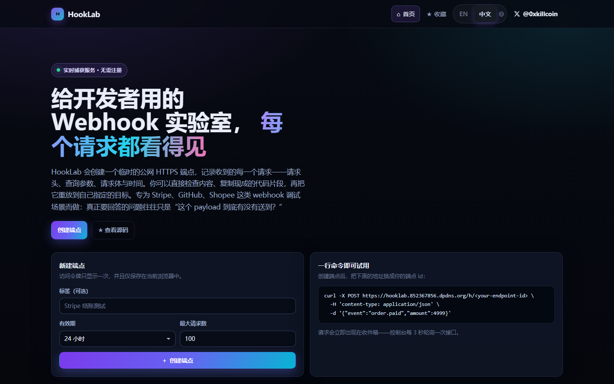

<div align="right">

**简体中文** · [English](README.md)

</div>

# HookLab

> **给开发者用的 Webhook 实验室：在真实的公网地址上捕获、检查并重放 HTTP 请求。**

HookLab 会给你一个用完即弃的 HTTPS 端点，记录收到的每一个请求——方法、路径、查询参数、请求头、请求体与时间——
让你在几秒内回答「这个 webhook 到底有没有送到？它到底发了什么？」，而不是靠猜。需要复现问题时，把捕获到的请求
重放到你自己显式填写的目标，并且每一跳都经过 SSRF 防护。

<p align="center">
  <a href="https://hooklab.852367856.dpdns.org"><strong>🔗 在线演示 »</strong></a>
  &nbsp;·&nbsp;
  <a href="VERIFICATION.md"><strong>✅ 验证报告 »</strong></a>
</p>

<p align="center">
  
  
  
  
  
  
</p>

<p align="center">
  <a href="https://x.com/0xkillcoin"><strong>𝕏 @0xkillcoin</strong></a> ·
  <a href="#快速开始">快速开始</a> ·
  <a href="#api-说明">API</a> ·
  <a href="#安全模型">安全模型</a> ·
  <a href="#部署">部署</a>
</p>

---

## 目录

- [它解决什么问题](#它解决什么问题)
- [界面截图](#界面截图)
- [功能清单](#功能清单)
- [架构](#架构)
- [快速开始](#快速开始)
- [环境变量](#环境变量)
- [API 说明](#api-说明)
- [数据保留规则](#数据保留规则)
- [安全模型](#安全模型)
- [国际化](#国际化)
- [测试](#测试)
- [部署](#部署)
- [项目结构](#项目结构)
- [已知限制](#已知限制)
- [路线图](#路线图)
- [参与贡献](#参与贡献)
- [开源许可](#开源许可)

---

## 它解决什么问题

Webhook 调试通常是一个靠猜的循环：

1. 支付平台说它发了事件，你的处理程序说它从没收到。
2. 你加日志、重新部署，再让平台重发一次。
3. 还是不对——某个请求头、某个签名、某个编码、某次跳转。

HookLab 把「猜」这一步删掉。它是一个**真正的服务端接收器**（Cloudflare Worker + D1），不是浏览器里的模拟页面：
任何外部客户端——Stripe、GitHub、你的 CI、另一台机器上的 `curl`——都可以 POST 到你的端点，请求会在几秒内
被存储并显示在实时控制台里。

**适合谁：** 正在对接第三方 webhook 的后端工程师、需要复现偶发回调的测试同学，以及任何只是需要一个稳定公网
地址五分钟、而不想搭内网穿透的人。

## 界面截图

所有截图都由 [`scripts/verify-ui.mjs`](scripts/verify-ui.mjs) 从**线上生产环境**自动截取
（Playwright，桌面 + iPhone 视口）。

| 收件箱（桌面） | 请求详情（桌面） |
| --- | --- |
|  |  |

| 重放实验室（桌面） | 首页（桌面） |
| --- | --- |
|  |  |

| 英文界面 — 收件箱 | 英文界面 — 请求详情 | 英文界面 — 重放 |
| --- | --- | --- |
|  |  |  |

| iPhone — 收件箱 | iPhone — 请求详情 | iPhone — 重放 |
| --- | --- | --- |
|  |  |  |

## 功能清单

### 捕获
- **临时公网端点**：96 位随机 slug + 256 位访问令牌（`hl_…`）。
- **任意 HTTP 方法与内容类型**：JSON、`application/x-www-form-urlencoded`、纯文本、XML，以及任意二进制
  （以 base64 存储、计算 SHA-256，绝不会当作 HTML 渲染）。
- **完整保真**：方法、路径、查询参数（重复键也保留）、全部请求头、字节数、接收时间、User-Agent、粗粒度国家。
- **处理 CORS 预检**，浏览器端的发送方也能正常使用。

### 检查
- **每 3 秒轮询刷新**（标签页切到后台时自动暂停）——不受免费套餐 WebSocket 连接数限制，睡眠唤醒和弱网都能恢复。
- **搜索**：跨路径、请求体文本、User-Agent；**筛选**：按 HTTP 方法与来源。
- **格式化 / 原始双视图**：JSON 美化、表单字段解码、纯文本原始内容、二进制 base64 转写。
- **复制**：任一字段、全部请求头、整个请求体，或直接生成可执行的 cURL 命令。
- **来源明确标注**：每一行都标记为 `● 真实请求` 或 `◇ 测试请求`，平台永远不会把模拟请求冒充成真实流量。

### 重放
- **目标必须显式填写**——HookLab 绝不会重放到隐含目标或记忆中的目标。
- **逐跳 SSRF 防护**：私有段 / 回环 / 链路本地 / CGNAT / 组播、IPv4 映射与 NAT64 形式、云元数据主机、
  内部 TLD、非 80/443/8080/8443 端口、带凭据的 URL，全部拒绝。
- **请求前校验 DNS、响应后再校验一次**以捕获 DNS 重绑定；重定向手动跟随（最多 5 跳，每跳重新校验）。
- **响应有界**：10 秒超时、8 KB 响应体预览、最多 40 个响应头。
- **限流**：每个端点每分钟 20 次、每天 200 次。

### 管理
- **服务端强制配额**：有效期、最大存储请求数、每分钟入站限流、128 KiB 请求体上限、每端点 4 MiB 存储，
  外加每个 IP 每日创建端点上限。
- **保留策略**：每个请求都有自己的过期时间；写入时顺带清理，过期端点立即停止接收流量。
- **删除**：删除单条请求、清空全部请求、轮换令牌、销毁端点。
- **脱敏导出**：下载 JSON 调试报告，敏感头已替换为 `[REDACTED]`。
- **令牌轮换**使旧令牌立即失效（服务端只存 SHA-256 哈希）。

### 界面
- **中英双语界面**，头部 `EN | 中文` 一键切换。选择会存入 `localStorage`，并在首帧渲染前应用到
  `<html lang>`（不会闪一下错误语言），同时驱动 `Intl` 的日期/数字/相对时间格式化。首次访问自动跟随浏览器语言。
- **从 320px 起完全自适应**：手机端单列收件箱、图标化导航、长请求体滚动折叠、点击目标 ≥ 28px。
  已在模拟 iPhone 视口与 320px 窄屏下通过浏览器自动化验证。

## 架构

```
                    ┌──────────────────────────────────────────────────────────┐
  Stripe / GitHub   │  Cloudflare Worker（单次部署、单一源站）                    │
  curl / CI  ──────▶│                                                          │
                    │   /h/:slug      → 入站处理器  ──┐                         │
                    │   /api/*        → JSON API     ──┼──▶  D1 (SQLite)          │
                    │   /*            → 静态 SPA 资源 ┘                         │
                    │                                                          │
                    │   重放 ──▶ SSRF 防护 ──▶ fetch(目标) ──▶ 跳转链记录         │
                    └──────────────────────────────────────────────────────────┘
                                        ▲
                             React 19 + TypeScript SPA
                             （Vite 构建，由 Workers 静态资源托管）
```

| 层次 | 选型 | 理由 |
| --- | --- | --- |
| 边缘运行时 | Cloudflare Workers | 真实公网入站 HTTP、免费额度充足、全球 Anycast |
| 数据库 | Cloudflare D1 (SQLite) | 无服务器的 SQL，免费额度，无需管理连接池 |
| 前端 | React 19 + TypeScript + Vite | 打包体积小（约 97 KB gzip），不依赖路由库（自研 3 KB 路由） |
| 静态托管 | Workers 静态资源 | 与 API 同源 → 控制台无需 CORS 配置，一次部署搞定 |
| 实时更新 | 受控轮询 | 对免费额度友好、抗弱网，比管理 SSE/WebSocket 限制更简单 |
| 测试 | `node:test` + Playwright | 单测零额外运行时；浏览器 E2E 验证真实响应式表现 |

Worker 是唯一的活动部件：它同时提供 SPA、JSON API 和入站路由。没有需要保温的独立后端，也没有冷启动数据库。

## 快速开始

```bash
git clone https://github.com/iiiiiiiiiiiiiKK/hooklab.git
cd hooklab
npm install
```

### 1. 创建数据库

```bash
npx wrangler d1 create hooklab-db
# 把打印出来的 database_id 填到 wrangler.jsonc
npx wrangler d1 execute hooklab-db --remote --file=migrations/0001_init.sql
```

### 2. 本地运行

```bash
npm run build          # 把 SPA 构建到 dist/
npm run dev:worker     # wrangler dev，监听 http://127.0.0.1:8787
```

想要前端热更新，就在第二个终端跑 `npm run dev`（Vite 监听 :5173），它会把 `/api` 代理到 `127.0.0.1:8787`。

### 3. 发送第一条请求

在界面里创建端点（或者用 `curl -X POST /api/endpoints`），然后：

```bash
curl -X POST http://127.0.0.1:8787/h/<你的端点-id> \
  -H 'content-type: application/json' \
  -H 'x-api-key: sk_live_demo' \
  -d '{"event":"order.paid","amount":4999}'
```

打开控制台，请求已经出现，`x-api-key` 显示为 `[REDACTED]`。

## 环境变量

HookLab 全部从环境变量（Wrangler 的 `vars` / secrets）读取配置，没有任何硬编码。

| 变量名 | 是否必需 | 默认值 | 用途 |
| --- | --- | --- | --- |
| `DB` | 是 | `wrangler.jsonc` 中的绑定 | D1 数据库绑定 |
| `ASSETS` | 是 | `wrangler.jsonc` 中的绑定 | SPA 静态资源绑定 |
| `ALLOWED_REPLAY_HOSTS` | 否 | *（空 = 任意公网主机）* | 逗号分隔的白名单，例如 `mycompany.io,hooks.example.com`。设置后重放被限制在这些主机及其子域。 |
| `ALLOWED_REPLAY_PORTS` | 否 | *（空）* | 在 80/443/8080/8443 之外额外允许的重放端口。 |
| `IP_HASH_SECRET` | 建议设置 | `hooklab` | 限流所用 IP 哈希的加盐值。用 `wrangler secret put IP_HASH_SECRET` 设置。 |
| `DEBUG_ERRORS` | 否 | *（未设置）* | 设为 `1` 时在 500 响应里附带错误信息（绝不会包含请求内容）。生产环境保持关闭。 |

模板见 [`.env.example`](.env.example)。**永远不要把真实密钥提交进仓库**——本项目运行不需要任何第三方 API Key。

## API 说明

所有 API 响应均为 JSON。需要鉴权的路由要求把端点令牌放在 `x-hooklab-token: hl_…`
（也支持 `Authorization: Bearer hl_…`）。

### 创建端点

```http
POST /api/endpoints
Content-Type: application/json

{
  "name": "Stripe 结账测试环境",
  "ttlMinutes": 1440,
  "retentionMinutes": 60,
  "maxRequests": 100,
  "rateLimitPerMinute": 60,
  "storeSensitiveHeaders": false
}
```

```json
{
  "endpoint": {
    "id": "6d1f…",
    "slug": "Qm9v…",
    "status": "active",
    "expiresAt": 1792880000000,
    "maxRequests": 100,
    "requestCount": 0,
    "retentionMinutes": 60,
    "rateLimitPerMinute": 60,
    "tokenHint": "a1b2…z9y8",
    "ingestPath": "/h/Qm9v…"
  },
  "token": "hl_…",
  "ingestUrl": "https://hooklab.example.com/h/Qm9v…"
}
```

> 令牌**只返回一次**，服务端只保存 `sha256(token)`。

### 入站（给第三方平台填的那个 URL）

```http
POST /h/:slug
```

返回 `202 Accepted` 与存储序号；端点不存在返回 `404`，已过期返回 `410`，请求体超过 128 KiB 返回 `413`，
触发限流或数量上限返回 `429`，端点存储配额用尽返回 `507`。

### 其他路由

| 方法 | 路径 | 鉴权 | 说明 |
| --- | --- | --- | --- |
| `GET` | `/api/health` | — | 服务状态 + 限制参数 |
| `GET` | `/api/endpoints/:id` | 令牌 | 端点信息 + 用量统计 |
| `PATCH` | `/api/endpoints/:id` | 令牌 | `name`、`status`、`maxRequests`、`rateLimitPerMinute`、`extendMinutes`、`storeSensitiveHeaders` |
| `DELETE` | `/api/endpoints/:id` | 令牌 | 销毁端点、请求与重放记录 |
| `POST` | `/api/endpoints/:id/rotate-token` | 令牌 | 换新令牌，旧令牌立即失效 |
| `GET` | `/api/endpoints/:id/requests?since=&q=&method=&origin=&limit=` | 令牌 | 收件箱列表 |
| `GET` | `/api/endpoints/:id/requests/:requestId` | 令牌 | 请求完整详情 |
| `DELETE` | `/api/endpoints/:id/requests/:requestId` | 令牌 | 删除单条请求 |
| `DELETE` | `/api/endpoints/:id/requests` | 令牌 | 清空全部请求 |
| `POST` | `/api/endpoints/:id/replay` | 令牌 | 重放到显式目标 |
| `GET` | `/api/endpoints/:id/replays` | 令牌 | 重放历史 |
| `POST` | `/api/endpoints/:id/test-request` | 令牌 | 生成一条**合成**请求（带标记） |
| `GET` | `/api/endpoints/:id/export?scope=summary\|all` | 令牌 | 脱敏 JSON 报告 |

### 重放

```http
POST /api/endpoints/:id/replay
x-hooklab-token: hl_…

{
  "targetUrl": "https://staging.example.com/webhooks/stripe",
  "requestId": "…",
  "method": "POST",
  "headers": [["x-debug-run", "1"]],
  "includeBody": true
}
```

```json
{
  "replay": {
    "statusCode": 200,
    "statusText": "OK",
    "durationMs": 412,
    "ok": true,
    "finalUrl": "https://staging.example.com/webhooks/stripe",
    "hops": ["https://staging.example.com/webhooks/stripe"],
    "dnsRebindingSuspected": false,
    "bodyPreview": "{\"received\":true}",
    "responseHeaders": [["content-type", "application/json"]]
  }
}
```

可以依赖的错误码：`invalid_target`、`blocked_target`、`blocked_port`、`host_not_allowlisted`、
`dns_lookup_failed`、`too_many_redirects`、`replay_timeout`、`replay_rate_limited`、`replay_quota_exceeded`、
`dns_rebinding_suspected`。

## 数据保留规则

| 规则 | 取值 | 执行方式 |
| --- | --- | --- |
| 端点有效期 | 10 分钟 – 30 天（默认 24 小时） | 每次请求都校验 `expires_at` |
| 请求保留时长 | 5 分钟 – 7 天，且不超过端点有效期 | 每行的 `expires_at` |
| 最大存储请求数 | 每端点 1 – 500 | 入站时的原子计数器 |
| 请求体上限 | 128 KiB | 流式截断，超限在缓冲前就拒绝 |
| 每端点存储 | 4 MiB | 运行中的字节计数器 |
| 入站限流 | 每 IP 每端点 1 – 300 次/分钟（默认 60） | D1 固定窗口计数器 |
| 重放限流 | 每端点 20 次/分钟、200 次/天 | 固定窗口计数器 |
| 端点创建 | 每 IP 哈希 20 个/天 | 固定窗口计数器 |

过期数据在任何读取路径上都会立即不可见，并由「流量触发的同步清理 + 每 6 小时一次的 Cron Trigger」
（`wrangler.jsonc` 里的 `triggers.crons`）删除，因此闲置部署也不会堆积数据。过期端点立即停止接收流量；
端点删除后不留任何数据；超过 6 小时的限流窗口也会被清理。

## 安全模型

**威胁模型。** 互联网上任何人都能创建端点并向它发送请求。只有持有令牌的人才能读取捕获到的内容。
重放本质上是一个请求伪造原语，因此受到最严格的控制。

| 风险 | 控制措施 |
| --- | --- |
| 端点枚举 | 96 位随机 slug，无列表接口，无公开目录 |
| 未授权读取 | 256 位令牌，只返回一次，仅存 SHA-256；所有读写路由都要求提供 |
| 令牌泄露 | 令牌永不写日志；`token_hint` 只显示 43 个字符中的 8 个；可立即轮换 |
| 凭据采集 | `authorization`、`cookie`、`*token*`、`*secret*`、`*api-key*`、`password`、`signature`、`session` 在存储前替换为 `[REDACTED]`，除非端点显式选择保留 |
| 请求体滥用 | 128 KiB 上限、每端点 4 MiB、请求数上限、每分钟入站限制、每 IP 创建限制 |
| SSRF / 内网访问 | 协议白名单；IPv4/IPv6 字面量解析（点分、十进制、十六进制、八进制、映射、NAT64）；屏蔽 RFC1918、回环、链路本地、CGNAT、组播、保留段；屏蔽云元数据主机名；屏蔽内部 TLD；屏蔽非标准端口；请求前用 DoH 校验 DNS、请求后再校验；重定向手动跟随并逐跳复核 |
| DNS 重绑定 | 比较请求前与响应后的解析结果；若出现新的私有地址则标记 `dns_rebinding_suspected` |
| 构造攻击流量 | 只能显式指定目标、不保存目标、方法白名单、20 次/分钟 + 200 次/天、超时、8 KB 响应上限 |
| XSS | React 转义全部数据；无 `dangerouslySetInnerHTML`；请求体渲染在 `<pre>` 内；未知字节以 base64 展示，绝不作为 HTML；`X-Content-Type-Options: nosniff` |
| 日志泄露 | Worker 日志只包含错误引用、路由与错误类型——绝不含请求内容、请求头或令牌 |
| 数据残留 | 逐行过期、顺带清理、手动清空、删除端点、脱敏导出 |
| CSRF | 令牌由 SPA 以自定义请求头发送，从不使用 Cookie，跨站表单提交无法通过鉴权 |

**不在范围内（如实说明）：** HookLab 不是签名校验服务；除 Cloudflare 平台自身的加密外，它不对请求体做额外
加密存储；它也不是多租户账号系统——令牌*就是*账号。如果需要团队账号，请把它放在你自己的鉴权代理之后，
或实现下方路线图中的条目。

## 国际化

界面提供**英文与中文**。`src/i18n.tsx` 把两份字典放在同一张带类型的表里，因此漏一个 key 是 TypeScript 编译错误，
漏一句翻译会被 `tests/i18n.test.mjs` 捕获。

- 切换器在页面头部（`EN | 中文`），是两段式按钮而不是下拉菜单——手机上一键点到，不用展开菜单。
- 选择存入 `localStorage["hooklab.lang"]`；`index.html` 里的一小段内联脚本会在**首帧之前**把它应用到
  `<html lang>`，因此不会闪一下错误语言。
- 首次访问回退到 `navigator.language`（`zh*` → 中文，其他 → 英文）。
- `Intl` 格式化跟随当前语言：日期、时间、相对时间分别使用 `en-US` / `zh-CN`，不会中英混排。
- 服务端错误码映射为翻译后的整句（`err.<code>`），例如 `blocked_target` 在中文下显示为自然的中文提示，
  而不是直接暴露英文 API 原文；未知错误码安全回退到服务端文案。
- 中文使用 CJK 优先字体栈并略放宽行高；英文标题保留更紧凑的字距。

新增语言：在 `Lang` 中加一个成员、加一份 `Record<TextKey, string>` 类型的字典、在 `LOCALES` 中加一条——
编译器会把所有还没翻译的 key 列出来。

### 文档

本文件与英文版 README 同步维护：

| 文件 | 语言 |
| --- | --- |
| [`README.md`](README.md) | English（默认） |
| [`README.zh-CN.md`](README.zh-CN.md) | 简体中文 |

两份文件顶部都有语言互链。`tests/readme.test.mjs` 会守住这条底线：断言两份文件的章节标题数量一致、
都包含线上地址与 𝕏 作者链接，也不会出现「只在一份文档里描述的功能」。给其中一份加章节时，另一份也要加，
否则单元测试会失败。

## 测试

```bash
npm test                      # 单元测试（node:test）：SSRF、令牌/请求体处理、脱敏、i18n
node scripts/verify-ui.mjs    # 针对已部署实例的浏览器 E2E + 截图
node scripts/check-narrow.mjs # 320px 窄屏回归（中英双语各跑一遍）
```

单元测试覆盖（`tests/`）：

- `ssrf.test.mjs` —— IPv4/IPv6 解析、屏蔽段、协议、端口、白名单、元数据主机。
- `util.test.mjs` —— 令牌/slug 熵、哈希、敏感头脱敏、请求体分类、流式字节上限。
- `i18n.test.mjs` —— 中英字典 key 完全一致、无空字符串、英文里的每个 `{占位符}` 在中文里都存在、
  客户端可能抛出的每个错误码都有译文。

端到端验证（`scripts/verify-ui.mjs`）在 1440×900 与 iPhone 390×844（DPR 3、触屏）下驱动**线上部署**，断言：
所有页面无横向溢出、点击目标 ≥ 28px、导航折叠、搜索/筛选行为、复制反馈、界面中可见脱敏结果、
SSRF 拒绝在界面上呈现、真实重放结果渲染、请求删除，以及语言切换（翻译 → 刷新 → 保持 → 切回）。
它会输出截图（含中文版本）以及 `screenshots/ui-verification.json`。

`scripts/check-narrow.mjs` 在 320px 宽度、中英双语下重复上述布局断言——这是头部元素最吃紧的宽度。

本仓库的生产环境验证结果记录在 [VERIFICATION.md](VERIFICATION.md)，其中包含从不同于构建机器的网络发起的
边缘端 API 套件（捕获、限制、鉴权、SSRF、重放、导出、删除）。

## 部署

### Cloudflare Workers（在线演示使用的方式）

```bash
npm install
npx wrangler d1 create hooklab-db                 # 仅需一次
npx wrangler d1 execute hooklab-db --remote --file=migrations/0001_init.sql
npx wrangler secret put IP_HASH_SECRET            # 可选，但建议设置
npm run deploy                                    # 构建 SPA 并部署 Worker + 静态资源
```

在 Workers → 你的 Worker → Settings → Domains & Routes 里绑定自定义域名，或直接使用生成的 `*.workers.dev`
主机名。免费套餐说明：每天 10 万次请求、每次请求 10ms CPU、D1 免费 5 GB 存储——HookLab 的端点级配额就是
为了稳稳落在这些额度之内而设计的，但**这是平台额度，不是「永久免费无限制」的承诺**。

> **关于 `*.workers.dev`：** 演示站点使用自定义域名 `hooklab.852367856.dpdns.org`，因为构建机器所在的网络
> 无法访问 `*.workers.dev`。如果你那边 workers.dev 域名超时，请绑定自己的域名——这是网络/运营商问题，
> 不是应用本身的问题。

### 没有 git push 权限时如何发布

如果到 GitHub 的 `git push` 被网络阻断、但 REST API 可达，`scripts/push-to-github.mjs` 会通过 API
（blobs → tree → commit → 移动 ref）镜像整棵已跟踪的文件树：

```bash
GH_TOKEN=... REPO_ROOT=$PWD GITHUB_REPO=owner/hooklab COMMIT_MESSAGE="feat: ..." \
  node scripts/push-to-github.mjs
```

### Vercel / 其他平台

HookLab 建立在 Workers 的原语之上（D1 绑定、`env.ASSETS`），因此**不是**一个可以直接丢到 Vercel 的应用。
迁移需要把 D1 换成其他 SQL 存储、把 Workers 静态资源换成平台自带的静态托管。GitHub Pages 也不行：
这个产品需要一个服务端运行时来接收 webhook。如果你确实需要 Node 运行时，`worker/` 里的逻辑就是普通的
`fetch` handler JavaScript，可以改写成 Hono/Express，再替换数据层。

## 项目结构

```
hooklab/
├── src/                     # React 19 + TypeScript SPA
│   ├── api.ts               # 带类型的 API 客户端 + 错误模型
│   ├── i18n.tsx             # 中英字典、Provider、useI18n()、错误文案本地化
│   ├── hooks.ts             # 端点会话 + 轮询 hooks
│   ├── router.tsx           # 3 KB 的 history 路由
│   ├── components/          # UI 基础组件（Toast、Chip、Modal、令牌输入）
│   ├── pages/               # 首页、收件箱、请求详情、重放、设置
│   └── styles.css           # 设计系统 + 响应式规则
├── worker/                  # Cloudflare Worker（JavaScript，无构建步骤）
│   ├── index.js             # 路由、入站管道、JSON API
│   ├── store.js             # 查询、配额、重放执行
│   ├── ssrf.js              # URL/IP 校验、DoH、重定向处理
│   └── util.js              # 令牌、哈希、请求体分析、限流
├── migrations/0001_init.sql # D1 表结构
├── tests/                   # node:test 单元测试（+ 用于验证的边缘探针）
├── scripts/
│   ├── verify-ui.mjs        # Playwright E2E + 截图流水线
│   ├── check-narrow.mjs     # 320px 双语回归
│   └── push-to-github.mjs   # REST API 发布脚本（git push 被阻断时的替代方案）
├── .github/workflows/ci.yml # 类型检查、单测、构建、Worker 试打包
└── wrangler.jsonc           # Worker、静态资源、D1 绑定与清理 Cron
```

## 已知限制

- **令牌即账号。** 没有注册流程，因此换设备后丢失的令牌无法找回——这是设计决定。如果你还有访问权限，
  可以在「设置」里轮换令牌。
- **轮询而非推送。** 收件箱每 3 秒刷新一次，不是亚秒级流式推送。
- **不能编辑请求。** 重放按原样发送捕获的请求体，只能附加额外请求头。
- **单区域数据库。** D1 由单一主库提供服务；远距离地域的写入延迟真实存在，但很小（HookLab 写入的都是小行）。
- **二进制预览为 base64。** 这是刻意的：不做内容嗅探，不执行 HTML。
- **`workers.dev` 在部分网络下不可达。** 请使用自定义域名（在线演示即如此）。
- **清理是分批的。** 每次清理最多删除 100 条过期行，以避免超出 Worker CPU 限制；大量积压需要几次调用才能清完。
  过期行在任何读取路径上本来就已不可见。
- **非多租户。** 没有组织、角色或审计日志。

## 路线图

- [x] 通过 Cron Triggers 定时清理（每 6 小时）
- [ ] 可选的 SSE 推送，作为轮询之外的第二种模式
- [ ] 签名校验辅助（Stripe、GitHub、Shopify）
- [ ] 按端点保存重放配置
- [ ] 导出为 HAR

## 参与贡献

欢迎提交 Issue 和 Pull Request。开 PR 之前请先跑 `npm test` 和 `node scripts/verify-ui.mjs`
（针对你自己的部署），并在行为发生变化时同步更新安全章节。安全相关问题请提交最小化的私密安全公告，
而不是带复现细节的公开 Issue。

## 开源许可

[MIT](LICENSE) © 2026 [@0xkillcoin](https://x.com/0xkillcoin)

<p align="center">
  用太多咖啡，以及太多次「这个 webhook 肯定发了」的争论做出来的。<br />
  <a href="https://x.com/0xkillcoin">在 𝕏 上关注作者</a>
</p>
